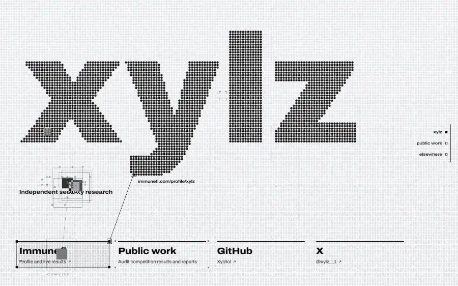
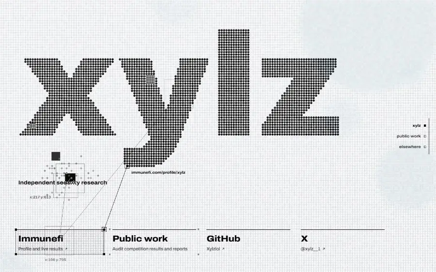
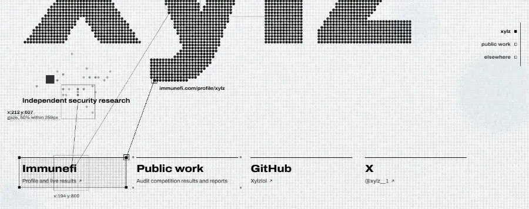
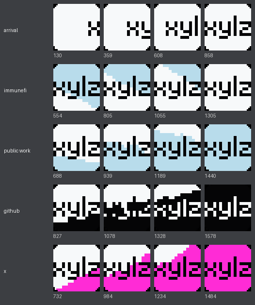

# xylz



Source for xylz.online, the personal site of xylz, a security researcher. It is a single page with links to Immunefi, the public reports, GitHub and X.

The page is drawn as an LED panel: a grid of round cells, and the name is made of lit cells. Each of the four links has its own background colour (white, sky blue, black, magenta). When you select a link, the new colour spreads across the grid from that link. Thin tracker lines mark the selected link and print where it goes.

It is plain HTML, CSS and JavaScript (about 4,100 lines, no framework, no build step, no WebGL) with one self-hosted font. The first load is 131 KB with brotli. A 3.5 MB neural network loads later, on desktops only.

## How the colour spreads

Each time a link is selected, a worker computes a new spread:

1. Every cell gets a random travel cost from a noise texture, with a new seed each time, so the shape differs every time.
2. Dijkstra's algorithm finds when the colour reaches each cell, moving to 8 neighbours. The costs are rounded to multiples of 1/32, so the queue can be an array of buckets instead of a heap ([Dial's algorithm](https://doi.org/10.1145/363269.363610)), which runs in linear time. Cells of the name cost three times as much, so the colour goes around the letters.
3. A second pass finds areas the colour is about to enclose. Each one fills from its edge as soon as it closes, so no cell is left to change after the spread ends.
4. Cells change in order of arrival, spread evenly over 1.1 s.
5. Each block of text changes colour when the spread reaches its centre, at the same time as the cells behind it, so it stays readable.

Computing a spread takes about 13 ms. It usually runs before the click, while the pointer is still moving toward the link (see the next section).



## When a selection counts

Moving the pointer across a link only moves the tracker to it. The colour changes when the pointer settles on the link:

- it stops on the link for 60 ms, or
- it slows below 0.12 px/ms for 40 ms, or
- it stays on the link, moving slowly, for 400 ms.

Clicking, keyboard focus and arrow keys select immediately. Sweeping across the row, passing over a link on the way elsewhere, scrolling the page under a still pointer and turning the mouse wheel do not change the colour.

While the pointer moves, the page also predicts which link it is heading for, from its recent velocity. It draws a dashed line to that link and computes its spread in advance.

`tools/pour_intent.py` tests this with real mouse input in Chrome: 13 cases, including fast and slow sweeps, aimed stops, clicks and keyboard.

## Where you are probably looking



The page estimates where your eyes are, without a camera, from the pointer and the page layout. Each estimated fixation is drawn as a box with its page coordinates. The label prints how uncertain the estimate is: "gaze, 50% within N px" means half of the estimate's probability lies within N pixels.

How it works, in a separate worker:

- A particle filter tracks 600 possible gaze points.
- Between updates, the points move like eyes: fixations of about 225 ms on text and 280 ms elsewhere; on a line of text, jumps of 7 to 9 characters forward, sometimes back, and to the next line at the end.
- Off text, the next fixation is drawn from a saliency map: a prediction of where people look on a screen.
- The saliency map comes from [UNISAL](https://github.com/rdroste/unisal), fine-tuned on [UEyes](https://zenodo.org/record/8010312) (1,980 interface screenshots with eye tracking from 62 people) on an RTX 4070 SUPER. It runs in its own worker with ONNX Runtime Web, in 110 to 150 ms, on a picture of the current view.
- The pointer position is the evidence. The hand follows the eyes by about 700 ms on average (Huang et al., summarised in [Navalpakkam et al. 2013](https://doi.org/10.1145/2488388.2488471)). When the pointer is heading for a link, the eyes are usually on that link already, so the link counts more than the pointer position. A pointer that has not moved for a while counts less.

Results of the fine-tuning on UEyes' held-out webpages (higher CC and NSS and lower KLD are better):

|                     | CC    | NSS  | KLD  |
|---------------------|-------|------|------|
| UNISAL, pretrained  | 0.331 | 0.87 | 1.45 |
| fine-tuned on UEyes | 0.620 | 1.59 | 0.79 |

The shipped model stores its weights as 8-bit integers: 3.5 MB, with a CC of 0.623 against 0.622 at full precision.

The pointer is a weak signal for exact eye position: in Navalpakkam's study the two correlate with r² < 0.05 at any given moment. That is why the page shows the uncertainty instead of a single point. The estimate runs only with a mouse or pen and stops 1.5 s after the last input.

## The tab icon

The tab icon is a 16 × 16 LED panel, one LED per pixel, spelling "xylz" in a hand-made pixel font: 4-pixel letters, a 1-pixel l and 1-pixel gaps make exactly 16 columns. On load, the name scrolls in from the right.

The colour spread continues into the icon. The page can't read where its tab is, so it estimates it from the browser window around it: wide borders at a side mean vertical tabs there, otherwise the tab bar is above, and the page aims at its middle because every position along the bar is equally likely. When the spread reaches the window edge in that direction, the icon fills from the same direction, and the browser's address-bar colour changes. Chrome updates tab icons about four times a second, so the icon changes in 250 ms steps.



## On phones

A finger touching a link usually starts a scroll, so touching does nothing. A tap selects the link and changes the colour. The selected link then shows an "open" button, at least 44 px tall, and only that button leaves the page. `tools/touch_test.py` tests this with simulated touch on a 390 px phone: 12 cases, including scrolls that start on each link and a fast swipe stopped by a tap.

## Performance

On a desktop Chrome (RTX 4070 SUPER), from `tools/perf_profile.py` and `tools/perf_ab3.py`:

| | |
|---|---|
| Main thread, idle | 0 % (everything stops 1.5 s after the last input) |
| Main thread, pointer circling the links | 9 % |
| Main thread, pointer over the name | 6 % |
| Main thread, scrolling | 4 % |
| Slowest frame while moving the pointer for 6 s | 13 to 18 ms |
| First load, compressed with brotli | 131 KB |
| Neural network and its runtime, loaded later on desktops with 4+ cores | 5.5 MB (brotli) |

With reduced motion turned on in the system settings, the colour changes at once instead of spreading, and the gaze estimate and other animations are off. The magnifier around the pointer stays, because it only moves when you move the pointer.

## Run it

```bash
python -m http.server 8765 --directory site
```

Then open http://localhost:8765/. After editing anything in `site/`, bump the `?v=` cache key (it appears in `index.html`, `main.js`, `wall-worker.js` and `gaze-worker.js`) and rebuild the pre-compressed copies:

```bash
python tools/compress.py
```

In production, serve the `.br` and `.gz` files directly (`brotli_static` / `gzip_static` in nginx). Without them, the neural assets cost 18 MB instead of 5.5 MB.

## What is where

```
site/                 the page, ready to serve as static files
  index.html          the page markup
  style.css           the four colour themes and all styles
  main.js             selection, pointer prediction, touch, tab icon, gaze display
  wall.js             the LED panel: cells, glow, pointer magnifier, the colour spread
  wall-worker.js      runs wall.js on an OffscreenCanvas
  gaze.js             the gaze particle filter
  gaze-worker.js      runs the filter and decides when a fixation starts
  saliency-worker.js  runs the saliency network with ONNX Runtime Web
  tab-icon.js         draws the 16 x 16 tab icon
  models/  vendor/  fonts/  art/
tools/                headless-Chrome checks, recorders and build scripts
ml/                   training and export code for the saliency model
media/                the images in this file, recorded by tools/record.py
DESIGN.md             the full design specification, with every value
```

## Checking changes

Everything in `tools/` drives a real Chrome over the DevTools protocol. It needs Python 3.10+ with `websocket-client`, `Pillow`, `numpy`, `brotli` and `onnxruntime`.

| Script | What it checks |
|---|---|
| `pour_intent.py` | the 13 mouse cases for when a selection counts (must pass 13/13) |
| `touch_test.py` | the 12 touch cases on a phone (must pass 12/12) |
| `perf_profile.py`, `perf_ab3.py`, `circle.py` | main-thread load, worst frames, long tasks |
| `interact.py`, `capture.py`, `mobile_shots.py` | screenshots after scripted input, at desktop, laptop and phone sizes |
| `saliency_gap.py` | compares the saliency map from the page's own drawing of the view with one from a real screenshot |
| `favicon_export.py`, `favicon_pour.py` | renders the icon files; records the tab icon while the colour changes |
| `record.py` | the animations in this README |

## Training the model

`ml/` holds what produced `site/models/ui_saliency.onnx`. `fetch_ueyes.py` pulls only the needed parts of the 13 GB UEyes archive with ranged requests. `train_ui.py` fine-tunes UNISAL with the dataset held on the GPU, in bf16 with OneCycle and early stopping. `export_onnx.py` and `weight_int8.py` produce the shipped file. The UNISAL code and pretrained weights come from its own repository and are not copied here.

## Credits

- [Archivo](https://github.com/Omnibus-Type/Archivo) by Omnibus-Type, SIL Open Font License 1.1 (`site/fonts/Archivo-OFL.txt`)
- [UNISAL](https://github.com/rdroste/unisal) by Droste, Jiao and Noble (ECCV 2020), Apache License 2.0 (`site/models/UNISAL-LICENSE.txt`)
- [UEyes](https://zenodo.org/record/8010312) by Jiang, Leiva, Tavakoli, Houssel, Kylmälä and Oulasvirta (CHI 2023), CC BY 4.0. The fine-tuned weights derive from it (`site/models/ATTRIBUTION.txt`)
- [ONNX Runtime Web](https://onnxruntime.ai/) 1.30.0, MIT License (`site/vendor/ort/LICENSE.txt`)

The site's own code and design: © xylz.
